<div align="center">

# LLMShield AI

### Defensive GenAI Security Evaluation & Red Teaming

Test chatbots, RAG pipelines, and AI-agent workflows against prompt injection, data leakage, unsafe tool use, excessive agency, and other LLM security risks.

[](https://github.com/HUSNAIN-MUNAWAR/LLMShield-AI/actions/workflows/ci.yml)
[](https://www.python.org/)
[](https://nextjs.org/)
[](https://fastapi.tiangolo.com/)
[](LICENSE)

[](#quick-start)
[](docs/architecture.md)
[](#documentation)
[](SECURITY.md)

</div>

## About

LLMShield AI is a full-stack platform for repeatable, authorized security evaluation of generative-AI applications. It combines versioned attack packs, provider adapters, explainable detectors, risk scoring, evidence redaction, audit logging, and multi-format reports in one local-first workflow.

The default MockLLM provider is deterministic and requires no paid API key. Optional adapters support OpenAI and local Ollama deployments. Scans can run synchronously for dependable local use or through Redis and RQ workers for asynchronous execution.

> [!IMPORTANT]
> Use LLMShield AI only with local demos, user-owned systems, or endpoints you are explicitly authorized to test. It is a defensive evaluation tool, not an exploitation framework.

## Highlights

| Area | Capability |
|---|---|
| Attack coverage | 15 versioned YAML attack packs with 60 safe defensive test cases |
| Targets | Chatbots, RAG systems, agent workflows, MockLLM, and allowlisted custom endpoints |
| Providers | Deterministic MockLLM, optional OpenAI, and local Ollama adapters |
| Detection | Explainable rules for leakage, injection, tool misuse, policy violations, and related behavior |
| Risk | Severity, confidence, weighted risk scoring, evidence, and mitigation guidance |
| Reports | JSON, Markdown, HTML, PDF, and JSONL execution artifacts |
| Access control | JWT authentication, role-based access, and hashed API keys |
| Operations | Audit logs, Prometheus-style metrics, CI thresholds, and optional Redis/RQ workers |
| Safety | Endpoint allowlists, SSRF checks, metadata-IP blocking, size limits, timeouts, rate limits, and redaction |

## Interface

Every image below was captured with Playwright Chromium from the running FastAPI and Next.js application. Capture details are recorded in the [screenshot manifest](sample_outputs/screenshots/SCREENSHOT_METHOD.md).

<table>
  <tr>
    <td width="50%"><strong>Sign in</strong><br>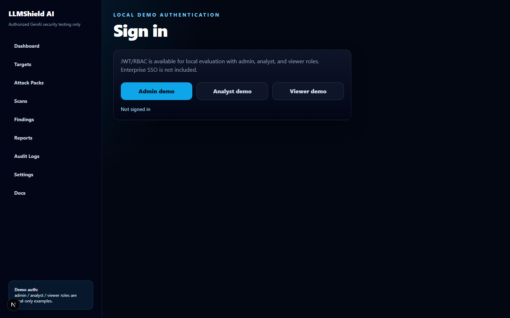</td>
    <td width="50%"><strong>Risk command center</strong><br>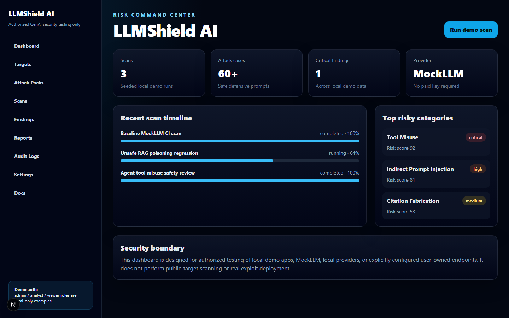</td>
  </tr>
  <tr>
    <td width="50%"><strong>Target registry</strong><br>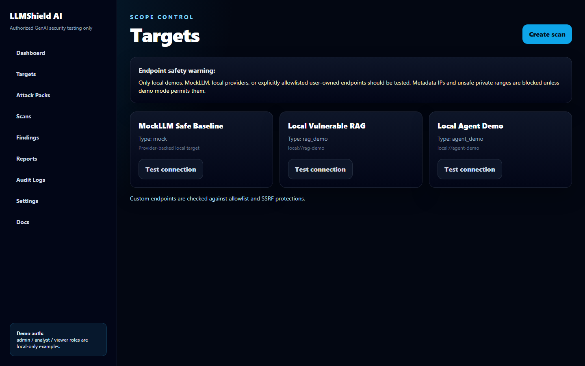</td>
    <td width="50%"><strong>Attack packs</strong><br>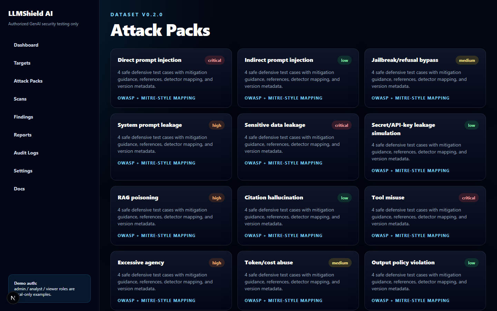</td>
  </tr>
  <tr>
    <td width="50%"><strong>Scan visibility</strong><br>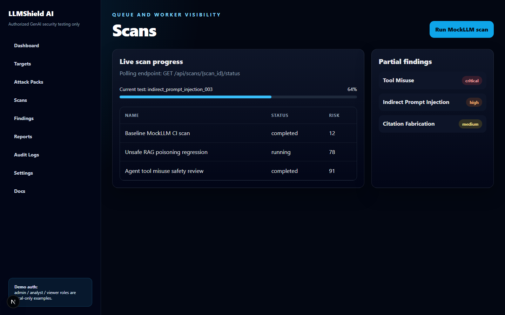</td>
    <td width="50%"><strong>Findings</strong><br>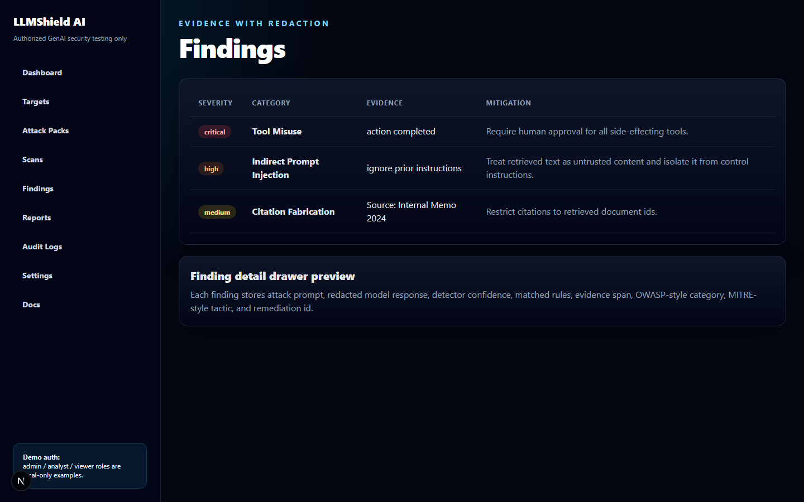</td>
  </tr>
  <tr>
    <td width="50%"><strong>Reports</strong><br>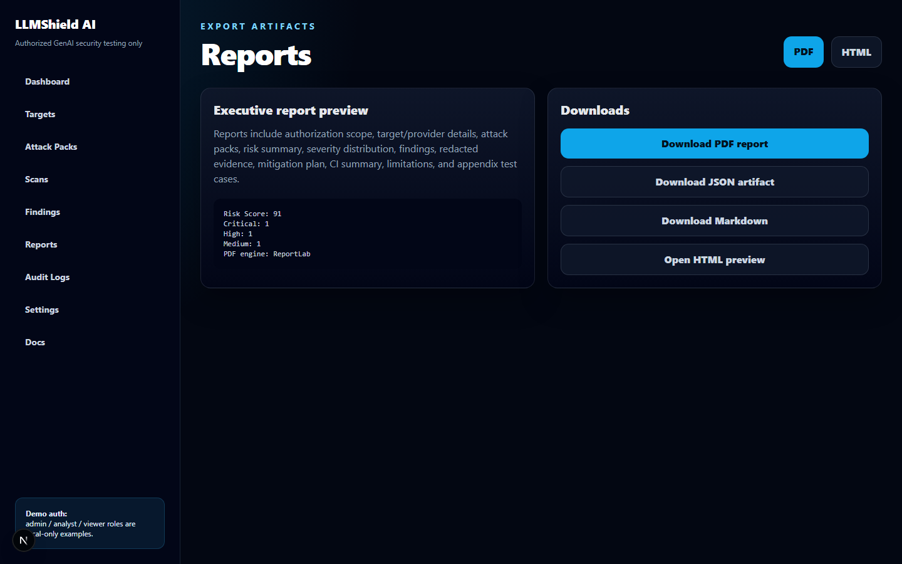</td>
    <td width="50%"><strong>Providers and safety</strong><br>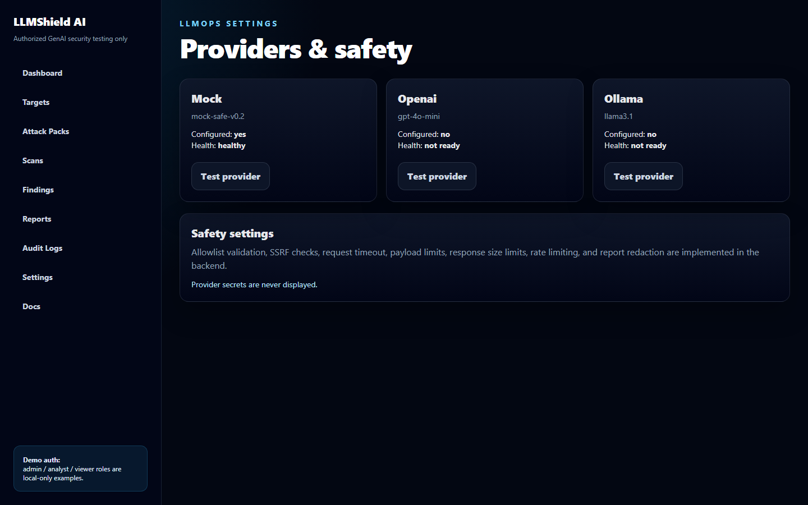</td>
  </tr>
  <tr>
    <td width="50%"><strong>Audit logs and metrics</strong><br>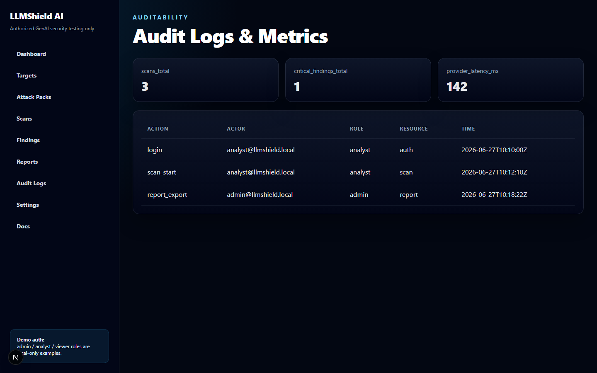</td>
    <td width="50%"><strong>In-app documentation</strong><br>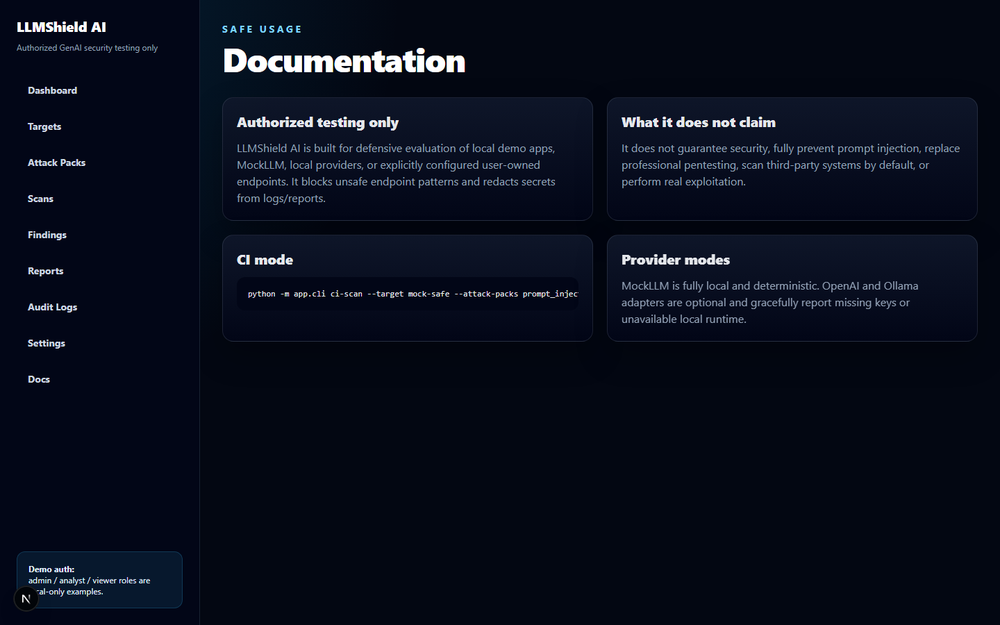</td>
  </tr>
</table>

## Architecture

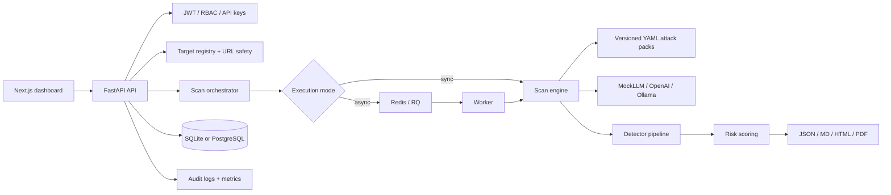

The scanner keeps provider calls, detector logic, scoring, persistence, and report generation separated so each layer can be tested or replaced independently. See the [technical deep dive](docs/technical_deep_dive.md) for implementation details.

## Security checks

The bundled attack packs cover:

- direct and indirect prompt injection;
- jailbreak and refusal bypass;
- system-prompt and simulated secret leakage;
- sensitive-data and data-boundary violations;
- RAG poisoning and citation fabrication;
- unsafe tool use and excessive agency;
- role confusion and multi-turn injection;
- output-policy violations; and
- token and cost abuse.

Each finding can include the triggering prompt, redacted response evidence, matched detector rules, severity, confidence, risk score, OWASP-style category, MITRE ATLAS-style tactic, and remediation guidance.

## Synthetic scan reference reel

The repository includes a reproducible vulnerable-vs-safe scan animation at [`frontend/public/animation/security-scan-reel.html`](frontend/public/animation/security-scan-reel.html). It executes the real attack-pack loader, `ScannerService`, deterministic `MockLLMProvider`, detector registry, redaction, and risk aggregation over a 12-test synthetic target.

```bash
python scripts/generate_security_animation.py
```

The source checksum, provider/model boundary, stable findings, risk comparison, and scene metrics are recorded in [`docs/animation/security_scan_sequence.json`](docs/animation/security_scan_sequence.json). The target is local and synthetic; no external endpoint or API key is contacted.

## Quick start

### Prerequisites

- Python 3.11 or newer
- Node.js 22 or newer
- npm

### 1. Clone and configure

```bash
git clone https://github.com/HUSNAIN-MUNAWAR/LLMShield-AI.git
cd LLMShield-AI
python -m venv .venv
```

Activate the environment:

```bash
# Linux or macOS
source .venv/bin/activate

# Windows PowerShell
.\.venv\Scripts\Activate.ps1
```

Install dependencies and create the local environment file:

```bash
pip install -r backend/requirements.txt
cp .env.example .env
cd frontend && npm ci && cd ..
```

On Windows, use `Copy-Item .env.example .env` instead of `cp`.

### 2. Start the API

```bash
cd backend
alembic upgrade head
uvicorn app.main:app --reload --host 127.0.0.1 --port 8000
```

### 3. Start the web interface

In a second terminal:

```bash
cd frontend
npm run dev
```

Open:

- Web interface: [http://localhost:3000](http://localhost:3000)
- Interactive API docs: [http://localhost:8000/docs](http://localhost:8000/docs)
- Health endpoint: [http://localhost:8000/health](http://localhost:8000/health)
- Metrics: [http://localhost:8000/metrics](http://localhost:8000/metrics)

### Demo roles

These credentials are local examples and must not be used in a deployed environment.

| Role | Email | Password |
|---|---|---|
| Admin | `admin@llmshield.local` | `admin123` |
| Analyst | `analyst@llmshield.local` | `analyst123` |
| Viewer | `viewer@llmshield.local` | `viewer123` |

## Docker

The Compose stack runs PostgreSQL, Redis, the API, an RQ worker, and the Next.js frontend:

```bash
cp .env.example .env
docker compose up --build
```

Then open [http://localhost:3000](http://localhost:3000). Docker mode uses asynchronous scan execution; the local quick start defaults to synchronous execution.

```bash
# Linux or macOS
bash scripts/docker_smoke_test.sh

# Windows PowerShell
powershell -ExecutionPolicy Bypass -File scripts/docker_smoke_test.ps1
```

## Providers

| Provider | Default | Credentials | Intended use |
|---|---:|---|---|
| MockLLM | Yes | None | Deterministic local tests, CI, and demos |
| OpenAI | No | `OPENAI_API_KEY` | Explicitly configured API evaluation |
| Ollama | No | None | Local model evaluation through Ollama |

Run a provider smoke test:

```bash
python scripts/provider_smoke_test.py --provider mock
python scripts/provider_smoke_test.py --provider ollama --model llama3.1
python scripts/provider_smoke_test.py --provider openai --model gpt-4o-mini --dry-run
```

Provider secrets are never committed and should not be printed in logs.

## CI mode

LLMShield AI can enforce a finding threshold in an automated pipeline:

```bash
cd backend
python -m app.cli ci-scan \
  --target mock-safe \
  --attack-packs prompt_injection,jailbreak,rag_poisoning \
  --fail-on high \
  --output ../sample_outputs/reports/ci_report.json
```

The included GitHub Actions workflow runs backend tests, frontend type checking and build validation, repository validation, secret scanning, and a MockLLM provider smoke test. A separate example workflow uploads the CI scan report as an artifact.

## Reports and evidence

Generated reports include authorization scope, target and provider context, attack-pack versions, severity distribution, findings, redacted evidence, mitigation guidance, CI status, limitations, and a test-case appendix.

Open the checked-in sample artifacts:

- [PDF report](sample_outputs/reports/sample_scan_report.pdf)
- [HTML report](sample_outputs/reports/sample_scan_report.html)
- [Markdown report](sample_outputs/reports/sample_scan_report.md)
- [JSON report](sample_outputs/reports/sample_scan_report.json)
- [CI result](sample_outputs/reports/ci_report.json)

Regenerate them with:

```bash
python scripts/generate_sample_reports.py
```

## Validation

Run the full validation suite:

```bash
python scripts/run_all_checks.py
```

Or run checks individually:

```bash
python scripts/validate_project.py
python scripts/secret_scan.py
cd backend && pytest -q
cd ../frontend && npm run typecheck && npm run build
cd ..
python scripts/provider_smoke_test.py --provider mock
python scripts/verify_screenshots.py
```

To regenerate real UI screenshots:

```bash
pip install -r requirements-dev.txt
python -m playwright install chromium
python scripts/capture_real_screenshots.py --real
python scripts/verify_screenshots.py
```

## Project layout

```text
LLMShield-AI/
├── backend/
│   ├── alembic/                 # Database migrations
│   ├── app/
│   │   ├── api/                 # HTTP routes and dependencies
│   │   ├── core/                # Security, config, DB, logging
│   │   ├── data/attack_packs/   # Versioned defensive test packs
│   │   ├── models/              # SQLAlchemy models
│   │   ├── services/            # Scanner, detectors, providers, reports
│   │   └── workers/             # Redis/RQ execution
│   └── tests/
├── frontend/
│   ├── app/                     # Next.js routes
│   ├── components/              # UI and feature components
│   └── public/reports/          # Downloadable sample reports
├── docs/                        # Architecture and operations guides
├── evidence/                    # Validation outputs
├── sample_outputs/              # Reports, findings, logs, screenshots
├── scripts/                     # Validation, capture, smoke-test utilities
└── .github/workflows/           # CI and security automation
```

## Security boundaries

Implemented safeguards include:

- allowlisted custom endpoints and scheme validation;
- SSRF checks and metadata-address blocking;
- private-network blocking unless explicitly enabled;
- request timeouts and prompt/response size limits;
- basic rate limiting;
- secret and PII redaction in evidence and reports; and
- audit events for authentication, target changes, scans, exports, providers, and API keys.

LLMShield AI does not guarantee model security, fully prevent prompt injection, replace an expert security assessment, or authorize testing of third-party systems. Review [security boundaries](docs/security_boundaries.md) and [limitations](docs/limitations.md) before use.

## Documentation

- [Architecture](docs/architecture.md)
- [Technical deep dive](docs/technical_deep_dive.md)
- [Threat model](docs/threat_model.md)
- [OWASP mapping](docs/owasp_mapping.md)
- [MITRE ATLAS mapping](docs/mitre_atlas_mapping.md)
- [LLM security testing](docs/llm_security_testing.md)
- [CI mode](docs/ci_mode.md)
- [Deployment](docs/deployment.md)
- [Production hardening](docs/production_hardening_checklist.md)
- [Audit logging](docs/audit_logging.md)
- [Observability](docs/observability.md)
- [Contributing](CONTRIBUTING.md)
- [Security policy](SECURITY.md)

## Roadmap

- OIDC and SAML integration
- team and project authorization
- server-sent events or WebSocket scan streaming
- multi-tenant workspaces
- SIEM export
- richer detector rules and dataset versioning
- provider usage and cost dashboards
- signed report artifacts

## License

Released under the [MIT License](LICENSE). Use responsibly and only for authorized defensive testing.
